<h1><strong>Sehjal Saxena</strong></h1>

<h3><strong>CSE Undergraduate &nbsp;·&nbsp; Developer &nbsp;·&nbsp; Curious by default</strong></h3>

 

&nbsp;&nbsp;

&nbsp;&nbsp;

&nbsp;&nbsp;

&nbsp;&nbsp;

 

<table width="100%">
<tr>
<td width="42%" align="center" valign="middle">
  
</td>
<td width="58%" valign="middle">

<pre>
<code>
const sehjal = {
  name: "Sehjal Saxena",
  role: "CSE Undergraduate",
  university: "Chitkara University",
  location: "India",

  interests: [
    "Software Development",
    "UI/UX & Product Design",
    "Artificial Intelligence"
  ],

  approach: "Learn by building."
};
</code>
</pre>

</td>
</tr>
</table>

---

## About Me

My relationship with computers started when I was around four years old. What began as childhood curiosity slowly turned into something much deeper.

Over the years, I've experimented, broken things, fixed things, dealt with viruses, managed to burn a PC once, and spent countless hours figuring out how technology works. Nearly 15 years later, that curiosity hasn't really gone anywhere.

I enjoy building things from scratch, exploring ideas, and finding solutions to problems that people actually face. I'm particularly drawn to the intersection of **technology, design, and product thinking.**

I have a soft spot for thoughtful interfaces and the little details that make a product feel right. I tend to notice inconsistencies, unnecessary friction, and things that could be done better. I enjoy refining them just as much as building the initial idea.

I'm still exploring different areas of Computer Science, figuring out what interests me most, and learning along the way.

## Tech Stack & Tools

  

## Selected Projects

I've worked on a range of projects across web development, AI, and experimentation. Here are a few highlights. You can explore more of my work in my <a href="https://sehjalsaxena.me/#projects">portfolio</a>.

<table width="100%">
<tr>
<td width="50%" valign="top">

<h3><a href="https://studydump.vercel.app/">StudyDump</a></h3>

A student-curated academic resource platform built to make engineering study materials easier to access.

<ul>
<li>Unit-wise notes and academic resources</li>
<li>Question banks and coding practice</li>
<li>Search, command palette, and exam-focused tools</li>
<li>Community-driven contributions</li>
</ul>

<a href="https://studydump.vercel.app/">Visit Website ↗</a>

</td>
<td width="50%" valign="top">

<h3><a href="https://github.com/sehjalsaxena/script-break">ScriptBreak / DemoPay</a></h3>

An AI-powered safety concept addressing coached UPI payment scams, developed for the RAKSHAM AI Cybersecurity Hackathon at IIT Delhi.

<ul>
<li>Context-aware scam detection</li>
<li>Pre-payment safety intervention</li>
<li>Android-based simulated payment application</li>
</ul>

<a href="https://github.com/sehjalsaxena/script-break">Explore Repository ↗</a>

</td>
</tr>
</table>

## GitHub Activity

  <picture>
    <source media="(prefers-color-scheme: dark)" srcset="assets/overview.dark.svg"/>
    
  </picture>

  <picture>
    <source media="(prefers-color-scheme: dark)" srcset="assets/languages.dark.svg"/>
    
  </picture>

## Outside the Usual

Not everything I explore has to become a software project.

I'm the kind of person who:

- Goes down unexpected research rabbit holes after coming across an interesting fact.
- Finds as much joy in photography, music, films, and design as in technology.
- Gets curious about how things work and occasionally takes them apart just to find out.
- Notices tiny details, experiments endlessly, and keeps tweaking things until they feel just right.
- Enjoys organizing, customizing, and figuring things out independently.
- Likes observing how people interact with products and interfaces, often wondering why something was designed a certain way.

I guess curiosity doesn't always follow a particular direction.

## Contributions

  <picture>
    <source media="(prefers-color-scheme: dark)" srcset="https://raw.githubusercontent.com/sehjalsaxena/sehjalsaxena/output/github-contribution-grid-snake-dark.svg"/>
    <source media="(prefers-color-scheme: light)" srcset="https://raw.githubusercontent.com/sehjalsaxena/sehjalsaxena/output/github-contribution-grid-snake.svg"/>
    
  </picture>

---

<i>Still learning. Still building. Still probably breaking things occasionally.</i>

